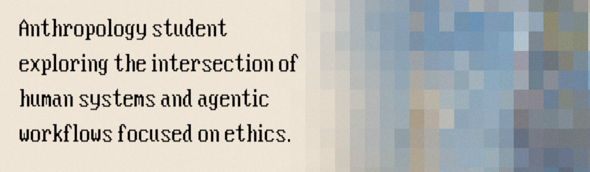

  

# Théophile Baudouin

I design and build agentic workflows, LLM context harnesses, and specialized AI systems.

### What I Do
*    **Agents:** Building reliable harnesses, execution pipelines, and local-first AI systems.
*    **Control:** Optimizing context management and system efficiency.
*    **Humanity:** Bringing structural, human-centered perspectives to software architecture.
* 🌱 **Cost & Eco-efficiency:** Committed to climate awareness by maximizing efficiency—empowering SLMs and deterministic tool orchestration to reach the capabilities of heavy models.

---

### Current Focus
* 🌸 **Metamorphia:** Software Engineer building internal/client AI tools and product architecture.  
  *(Belgian AI agency: [metamorph-ia.com](https://www.metamorph-ia.com/))*
* **Studies:** Student at UCLouvain (Belgium) in Sociology & Anthropology, with a minor in Political Science.
